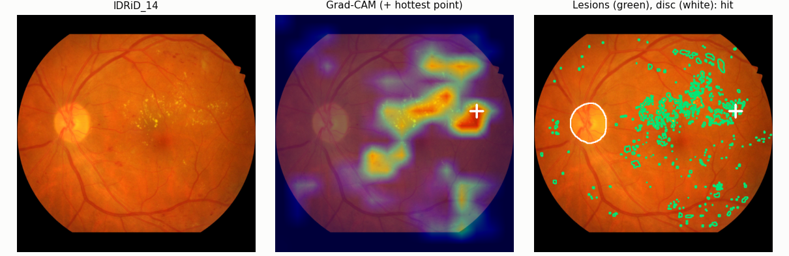

# Retinal DR Screening

[](https://github.com/ashwinruke/retina-screen/actions/workflows/tests.yml)
[](https://huggingface.co/spaces/ashwinruke/retina-dr-screening)

Grades diabetic retinopathy (0–4) from a colour fundus photo and decides
whether the eye needs referral to a specialist. Built to work beyond the
clinic it was trained on: pretrained on 88k EyePACS photos, fine-tuned on
APTOS 2019, and tested on IDRiD, a different Indian clinic and camera it never
saw during training.



**Key findings**

- **It holds up at a new clinic.** On IDRiD the model reaches a quadratic
  weighted kappa of 0.851 and a referable-DR AUC of 0.985. Pretraining on
  EyePACS cut the drop from the training clinic to the new one by more than
  half (0.153 → 0.086 QWK).
- **It looks at lesions, not shortcuts.** The heatmap's hottest point lands on
  a clinician-outlined lesion in 86% of 81 IDRiD photos (39% by chance), and the
  optic disc gets almost no attention.
- **The remaining gap is calibration, not recognition.** The model ranks new
  eyes correctly but scores them lower. Refitting the grade cut points on 83
  local photos raised severe-DR recall from 16% to 68%; retraining on 330
  added nothing more.
- **Two expected wins didn't hold**, and are reported as such: Ben Graham
  colour normalisation made no measurable difference, and a 5-class head
  matched the severity score on APTOS but missed 12 points more referable eyes
  on IDRiD.

**Live demo:** [huggingface.co/spaces/ashwinruke/retina-dr-screening](https://huggingface.co/spaces/ashwinruke/retina-dr-screening).
The model runs in your browser (ONNX Runtime Web), so photos are never uploaded.

> Research project, not a medical device.

## Results

Two models, both EfficientNet-B3 at 512 px, tested on the same images:

- **A0 (baseline):** ImageNet weights → fine-tuned on APTOS.
- **A1 (main model):** ImageNet weights → pretrained on all 88k EyePACS images
  (8 epochs, ~4.5 h on one Kaggle T4) → fine-tuned on APTOS.

The cut points between grades are fit on APTOS validation data (every grade
band at least 0.5 wide) and then frozen. IDRiD is never used for training,
model selection or tuning.

| | APTOS test (523) | | IDRiD, all 516 | |
|---|---|---|---|---|
| | A0 | **A1** | A0 | **A1** |
| Quadratic weighted kappa | 0.922 | **0.937** | 0.769 | **0.851** |
| Referable DR: ROC-AUC | 0.985 | **0.987** | 0.960 | **0.985** |
| Referable DR: sensitivity | 0.951 | **0.961** | 0.830 | **0.839** |
| Referable DR: specificity | 0.903 | **0.906** | 0.964 | **0.995** |
| Severe (grade 3) recall | 0.20 | **0.48** | **0.30** | 0.28 |
| Proliferative (grade 4) recall | 0.55 | **0.68** | 0.18 | **0.45** |

Referable DR = grade ≥ 2 (moderate or worse), the threshold for referral to an
eye specialist. The APTOS test split is 15% of the APTOS training set held out
before training, so it isn't comparable to the APTOS Kaggle leaderboard. On
IDRiD's official 103-image test set, QWK rises from 0.646 (A0) to 0.793 (A1).

### What EyePACS pretraining changed

- **The gap to a new clinic shrank by more than half.** A0 lost 0.153 QWK
  going from APTOS to IDRiD; A1 loses 0.086. Referable-DR AUC on IDRiD rose
  from 0.960 to 0.985, close to its APTOS level.
- **Proliferative disease is recognised far more often** on IDRiD
  (18% → 45%), and severe recall on APTOS more than doubled (20% → 48%).
  EyePACS has 1,940 severe and 1,773 proliferative training images; APTOS
  has about 115 and 175.
- **Severe disease on IDRiD is still the weak spot.** 61 of IDRiD's 93 severe
  eyes are graded moderate, so severe recall stayed at 28%. They are still
  flagged as referable, but without the urgency they need.
- **The referral cut-off is conservative on IDRiD.** At the frozen cut point
  A1 catches 84% of referable eyes with 99.5% specificity; most misses are
  moderate eyes graded mild. Read off the ROC curve, about 94% sensitivity is
  reachable at about 96% specificity, so a clinic adopting the model would recalibrate that
  one cut point on a small local sample.

### A1 on APTOS test


| | |
|---|---|
|  |  |

### A1 on IDRiD (external)

| | |
|---|---|
|  |  |

### Does the model look at the right things?

IDRiD includes 81 photos on which clinicians outlined every lesion
(microaneurysms, haemorrhages, hard and soft exudates) and the optic disc. For
each photo, A1's Grad-CAM heatmap was compared with those outlines in the
model's own 512 x 512 frame. Each score has a chance level next to it: what a
heatmap pointing at random spots on the retina would get.

| Check (81 photos) | A1 | Chance |
|---|---|---|
| Hottest point of the heatmap lands on a lesion (16 px tolerance) | **86%** | 39% |
| Share of the heatmap on lesions | **12.6%** (2.3x chance) | 5.5% (their share of the retina) |
| Share of the heatmap on the optic disc | **0.1%** | 2.6% |
| Hottest point on a haemorrhage | 48% | 15% |
| Hottest point on a hard exudate | 46% | 21% |
| Hottest point on a microaneurysm | 30% | 16% |
| Hottest point on a soft exudate (40 photos have them) | 10% | 4% |

- **It looks at lesions, not at shortcuts.** The hottest point lands on a lesion
  more than twice as often as chance, and the optic disc, a common shortcut for
  retina models, gets almost no attention.
- **Haemorrhages and hard exudates draw the most attention**, which fits:
  they are the larger lesions that mark moderate and severe disease.
- **Microaneurysms are the weakest match.** They are a few pixels across, while
  the heatmap comes from a 16 x 16 feature grid (32 pixels per cell), so it
  can't single them out.
- The chance level for "hits a lesion" is high (39%) because these photos were
  chosen for having many lesions, and the tolerance widens each one.


For eyes with no retinopathy (grade 0, first column above), nothing raises the
severity score, so Grad-CAM only stretches leftover noise to full colour, here
along the edges of the image. Those maps carry no meaning; the demo shows the
photo instead of a heatmap for grade 0.

### Cut points are fragile under a change of population

Tuning cut points on APTOS validation helps little and can hurt elsewhere.
On A0, the first version of the tuning squeezed the severe band to 0.19 wide
(fit to only 25 severe validation eyes) and graded only 9% of IDRiD's severe
eyes correctly. Requiring every band to be at least 0.5 wide raised that to
30%, and the plain defaults (0.5 / 1.5 / 2.5 / 3.5) did best on IDRiD (QWK
0.797 vs 0.769). The ranking of eyes, and so the referable-DR AUC, doesn't
depend on the cut points at all; only where the grade boundaries fall does.

### Adapting to a new clinic (A4)

How much local data does a clinic need? IDRiD's 413 training images were split
into 330 to train on and 83 to fit the cut points (stratified by grade), and
results are reported on IDRiD's 103 official test images, which none of these
steps touch.

| On IDRiD's 103 test images | A1 | **A4a: refit cut points** | A4: fine-tune + refit |
|---|---|---|---|
| Local data used | none | 83 images | 330 + 83 images |
| Quadratic weighted kappa | 0.793 | **0.822** | 0.803 |
| Referable DR: ROC-AUC | 0.956 | 0.956 | 0.956 |
| Referable DR: sensitivity / specificity | 0.781 / 1.000 | 0.812 / 0.949 | 0.844 / 0.923 |
| Severe (grade 3) recall | 0.16 | **0.68** | 0.68 |
| Proliferative (grade 4) recall | 0.54 | 0.62 | 0.62 |
| Cut points | 0.50 / 1.35 / 2.52 / 3.60 | 0.50 / 1.00 / 1.84 / 3.26 | 0.59 / 1.09 / 2.08 / 3.50 |

- **The gap at a new clinic is calibration, not recognition.** Refitting only
  the cut points on 83 local photos raised severe recall from 16% to 68% (13 of
  19 eyes). The refit boundaries are lower (severe starts at 1.84 instead of
  2.52): A1 ranks IDRiD eyes correctly but scores them lower than APTOS eyes of
  the same grade. This is the cause of the severe under-grading above.
- **Retraining added nothing on top.** Fine-tuning on 330 local photos peaked
  after its first epoch (validation QWK stayed flat for all 10), and the test
  AUC didn't move. A4's QWK (0.803) is within noise of A4a's (0.822).
- **In practice,** a clinic adopting this model needs about 80 labelled local
  photos to recalibrate the grade boundaries, not a retraining pipeline.
- **The test set is small** (103 images, 19 severe). Differences under about
  0.05 QWK are within chance; the 16% → 68% severe recall and the unchanged AUC
  are the robust parts.

### One severity score vs five classes (A3)

A3 is A1 with a 5-class head (cross-entropy) instead of one severity score;
everything else is the same. Its score is the expected grade under its
predicted probabilities, cut with cut points fit the same way as A1's. (A3's
head is trained during APTOS fine-tuning only; EyePACS pretraining stayed the
regression version.)

| | APTOS test | | IDRiD, all 516 | |
|---|---|---|---|---|
| | A1 (score) | A3 (5 classes) | A1 (score) | A3 (5 classes) |
| Quadratic weighted kappa | 0.937 | 0.943 | **0.851** | 0.819 |
| Referable DR: ROC-AUC | 0.987 | 0.989 | 0.985 | 0.982 |
| Referable DR: sensitivity / specificity | 0.961 / 0.906 | 0.941 / 0.947 | **0.839** / 0.995 | 0.715 / 1.000 |
| Severe / proliferative recall | 0.48 / 0.68 | 0.64 / 0.70 | 0.28 / 0.45 | 0.44 / 0.32 |

- **On the training source the head doesn't matter:** 0.943 vs 0.937 QWK is
  within run-to-run noise (~0.01).
- **At a new clinic the 5-class head misses more referable eyes:** IDRiD
  sensitivity falls from 84% to 72% (about 40 more of 323 referable eyes
  missed) while its AUC stays similar. It ranks eyes about as well, but its
  scores shift more under the new population, so the frozen referral cut-off
  fits worse.
- So the single severity score earns its place through robustness to a new
  clinic, not through accuracy on the source data. Single runs each; treat
  differences under ~0.02 QWK as noise.

### Ben Graham normalisation (A2)

A2 repeats A0 exactly (ImageNet → APTOS, same settings and splits) on plain
cropped photos, without Ben Graham colour normalisation.

| | APTOS test | | IDRiD, all 516 | |
|---|---|---|---|---|
| | A0 (normalised) | A2 (plain) | A0 (normalised) | A2 (plain) |
| Quadratic weighted kappa | 0.922 | 0.920 | 0.769 | 0.750 |
| Referable DR: ROC-AUC | 0.985 | 0.984 | 0.960 | **0.972** |
| Referable DR: sensitivity / specificity | 0.951 / 0.903 | 0.931 / 0.925 | **0.830** / 0.964 | 0.734 / 0.995 |

- **No measurable benefit.** The plan expected the normalisation to matter most
  for a new clinic; it didn't. APTOS is a tie, and on IDRiD the differences
  point both ways (QWK slightly lower without it, AUC slightly higher; on the
  103 official test images, QWK 0.688 without vs 0.646 with), all within noise.
- **The large sensitivity gap is calibration again:** A2's tuned referral
  cut-off landed at 1.47 instead of 1.30, while its ranking (AUC) is if
  anything better.
- A likely reason, untested here: an ImageNet-pretrained network trained with
  brightness and contrast augmentation already copes with colour differences
  between cameras. The normalisation stays in the pipeline (it costs nothing
  and the heatmap check above was done with it), but the README no longer
  claims it helps.

### Full comparison

**Across the ablations, one pattern:** at a new clinic the model's ranking of
eyes (referable-DR AUC) stays robust, but its score scale shifts. Most
differences in QWK and sensitivity at frozen cut points come from that shift,
and refitting the cut points on ~80 local photos corrects much of it (A4a).

| Run | APTOS test QWK | IDRiD QWK | IDRiD referable AUC | IDRiD sens / spec |
|---|---|---|---|---|
| A0 · ImageNet → APTOS | 0.922 | 0.769 | 0.960 | 0.830 / 0.964 |
| **A1 · EyePACS → APTOS (main)** | **0.937** | **0.851** | **0.985** | **0.839 / 0.995** |
| A2 · A0 without Ben Graham | 0.920 | 0.750 | 0.972 | 0.734 / 0.995 |
| A3 · A1 with a 5-class head | 0.943 | 0.819 | 0.982 | 0.715 / 1.000 |
| A4a · A1 + cut points refit on 83 IDRiD photos (IDRiD test only) | — | 0.822 | 0.956 | 0.812 / 0.949 |
| A4 · A1 fine-tuned on 330 IDRiD photos + refit (IDRiD test only) | — | 0.803 | 0.956 | 0.844 / 0.923 |

QWK = quadratic weighted kappa. IDRiD columns use all 516 images, except the
A4 rows, which use IDRiD's training images and report on its 103 test images
(on those 103: A0 QWK 0.646, A1 0.793). EyePACS pretraining reached 0.835
validation QWK on EyePACS itself; its labels are noisy, so that number is a
training signal, not a result.

## Data cleaning

APTOS contains the same photo several times, sometimes with different grades.
Copies that land on both sides of a train/test split inflate scores, and
conflicting labels are noise. Every image gets two fingerprints: its fine
detail (vessels, lesions) and its overall layout (optic disc position, which
eye). Two images count as copies only when both match.

| | Images |
|---|---|
| APTOS labelled images | 3,662 |
| Duplicate groups found | 131 |
| Extra copies removed (same grade, one kept) | 97 |
| Removed: copies with conflicting grades | 79 |
| **Used** | **3,486** |

Split 70 / 15 / 15, stratified by grade. Every flagged group is listed in
`data/manifests/aptos_duplicates.csv` for review.

## How it works

```
fundus photo → crop black border → pad to square → 512 px → Ben Graham normalisation
            → EfficientNet-B3 → GeM pooling → 1 regression output (severity 0–4)
            → thresholds tuned on val → grade 0–4 + Grad-CAM heatmap
```

Design decisions and their reasons are in [docs/PLAN.md](docs/PLAN.md):
why regression instead of 5-way classification, why patient-level splits on
EyePACS, why APTOS is deduplicated, and why IDRiD is held out entirely.

## Quickstart

### Dry run on synthetic data (CPU, ~1 minute)

```bash
pip install -r requirements.txt
python scripts/make_synthetic.py --out data/synthetic
python scripts/prepare_data.py --aptos data/synthetic/aptos --eyepacs data/synthetic/eyepacs \
    --idrid data/synthetic/idrid --out-dir data/manifests
python scripts/cache_images.py --manifest data/manifests/aptos.csv --out-dir data/synthetic_cache \
    --config configs/smoke.yaml --workers 2
python scripts/train.py --config configs/smoke.yaml
pytest
```

### Reproducing the results on Kaggle

The notebooks in [`notebooks/`](notebooks/) are the ones the results came
from. Kaggle wipes a session's files when it ends, so every run saves its
results to a private Hugging Face repo with `scripts/artifacts.py` and the
next session restores them instead of retraining.

| Notebook | What it does | Time on a T4 |
|---|---|---|
| `01_baseline_a0.ipynb` | Data cleaning, A0 training, APTOS + IDRiD evaluation, demo deploy | ~45 min |
| `02_restore_session.ipynb` | Start of every later session: restore saved results and caches | ~10 min |
| `03_eyepacs_pretrain_a1.ipynb` | EyePACS pretraining + APTOS fine-tuning (A1); run with *Save & Run All* | ~6 h |
| `04_ablations.ipynb` | A2, A3, A4 and the Grad-CAM lesion check | ~1.5 h |

Any config value can be overridden on the command line, e.g.
`python scripts/train.py --config configs/finetune_aptos.yaml model.backbone=convnext_tiny train.epochs=20`.

### Demo

The live demo is a static page (`web/`) that runs the model in the visitor's
browser with ONNX Runtime Web, so photos never leave their device and it
needs no server. Everything after crop-and-resize (colour normalisation, the
network, flip TTA and Grad-CAM) is inside the exported ONNX graph, and the
export checks itself against the PyTorch pipeline.

```bash
pip install onnx onnxscript onnxruntime
python scripts/export_onnx.py --model outputs/model.pt --out-dir web \
    --check-images cache/aptos.csv --report outputs/eval/mvp_aptos_test.json
python -m http.server -d web 8000                  # preview at http://localhost:8000
HF_TOKEN=... python scripts/deploy_space.py --space <user>/retina-dr-screening
```

`app/app.py` is the same demo as a server-side Gradio app
(`MODEL_PATH=outputs/model.pt python app/app.py`).

## Repo layout

```
configs/      one YAML per experiment (stage 1, stage 2, baseline, IDRiD adaptation, smoke test)
src/retina/   preprocess · manifests · data · model · engine (train/predict) · metrics
              gradcam · explain · export (ONNX)
scripts/      prepare_data · cache_images · train · evaluate · plot_results · explain
              export_onnx · deploy_space · artifacts · make_local_split · benchmark_gpu
              make_synthetic · build_space.sh
web/          in-browser demo (static page + ONNX model)
app/          the same demo as a Gradio app
notebooks/    the Kaggle notebooks the results came from (01-04)
.github/      CI: runs the tests on every push
tests/        unit tests + end-to-end test on synthetic data
docs/PLAN.md  the original plan, and what changed while building it
docs/figures/ result figures used in this README
```

## Data

The datasets are not included. Get them from their sources and follow their terms:

- [APTOS 2019 Blindness Detection](https://www.kaggle.com/competitions/aptos2019-blindness-detection) (Kaggle competition)
- [Diabetic Retinopathy Detection (EyePACS)](https://www.kaggle.com/competitions/diabetic-retinopathy-detection) (Kaggle competition)
- [IDRiD](https://ieee-dataport.org/open-access/indian-diabetic-retinopathy-image-dataset-idrid) (IEEE DataPort, CC BY 4.0)

## Limitations

- **Severe DR is under-graded at a new clinic** unless the cut points are refit
  on local photos (see A4). Those eyes are still flagged as referable.
- **Small external test sets.** IDRiD has 516 graded photos (103 in its official
  test set); differences under ~0.02 QWK on 516, or ~0.05 on 103, are within
  noise. Every comparison here is a single training run.
- **One image per eye, one model**, no ensembling. EyePACS labels are noisy.
- **Grades DR only.** It doesn't detect glaucoma, AMD or other conditions, and
  doesn't judge whether a photo is good enough to grade.
- **Grad-CAM is coarse** (a 16 x 16 grid), so it can't point at individual
  microaneurysms, and its maps for grade-0 eyes are noise.

## License

The code is MIT-licensed (see [LICENSE](LICENSE)). The datasets and anything
trained on them follow the datasets' own terms (above).
