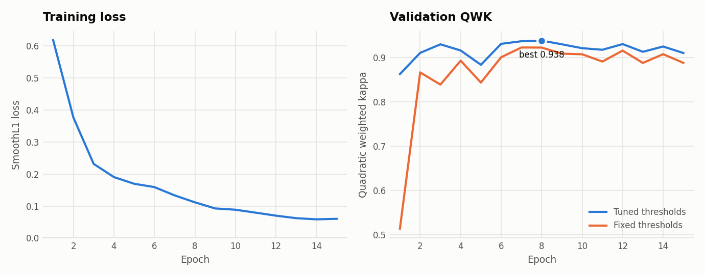
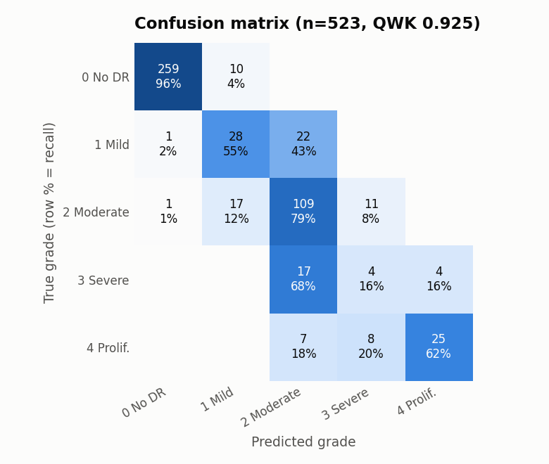
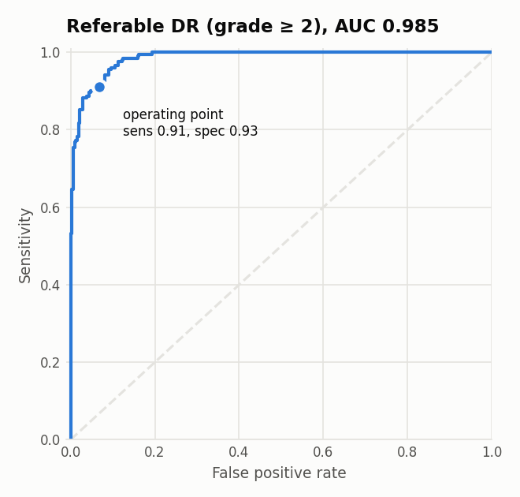

# Retinal DR Screening

Diabetic retinopathy grading from fundus photographs, built to generalise
beyond the dataset it was trained on:

- **Pretrained** on Kaggle EyePACS 2015 (~88k images)
- **Fine-tuned** on APTOS 2019 (3.6k images, Aravind Eye Hospital)
- **Externally tested** on IDRiD (516 images, a different Indian clinic and camera, never seen in training)
- **Explained** with Grad-CAM heatmaps
- **Demo** on Hugging Face Spaces

> Research project, not a medical device.

**Status:** MVP done (APTOS baseline, results below). Next: live demo, IDRiD
external test, then EyePACS pretraining.

<!-- Replace with your Space link once deployed -->
**Live demo:** _coming soon_

## Results

### MVP baseline: ImageNet → APTOS (no EyePACS yet)

EfficientNet-B3 at 512 px, 15 epochs on one Kaggle T4 (~17 min). Evaluated on a
held-out 15% of APTOS (523 images) that was never used for training, model
selection or threshold tuning.

| Metric | APTOS test |
|---|---|
| Quadratic weighted kappa | **0.917** (0.879 with default cut points) |
| Accuracy (5 grades) | 0.816 |
| Referable DR (grade ≥ 2): ROC-AUC | **0.986** |
| Referable DR: sensitivity / specificity | 0.970 / 0.897 |



| | |
|---|---|
|  |  |

This test split comes from the APTOS training set, so these numbers are not
comparable to the APTOS Kaggle leaderboard (a different, hidden test set).

### Full comparison

_Filled in as each step lands. Cut points fit on APTOS val, then frozen._

| Run | APTOS test QWK | IDRiD QWK | IDRiD referable AUC | IDRiD sens / spec |
|---|---|---|---|---|
| A0 · ImageNet → APTOS | 0.917 | | | |
| **A1 · EyePACS → APTOS (main)** | | | | |
| A2 · A1 without Ben Graham | | | | |
| A3 · A1 with classification head | | | | |
| A4 · A1 + IDRiD fine-tune (IDRiD test only) | — | | | |

QWK = quadratic weighted kappa. Referable DR = grade ≥ 2.

## Data cleaning

APTOS contains the same photo several times, sometimes with different grades.
Copies that land on both sides of a train/test split inflate scores, and
conflicting labels are noise. Every image gets two fingerprints: its fine
detail (vessels, lesions) and its overall layout (optic disc position, which
eye). Two images count as copies only when both match.

| | Images |
|---|---|
| APTOS labelled images | 3,662 |
| Duplicate groups found | 131 |
| Extra copies removed (same grade, one kept) | 97 |
| Removed: copies with conflicting grades | 79 |
| **Used** | **3,486** |

Split 70 / 15 / 15, stratified by grade. Every flagged group is listed in
`data/manifests/aptos_duplicates.csv` for review.

## How it works

```
fundus photo → crop black border → pad to square → 512 px → Ben Graham normalisation
            → EfficientNet-B3 → GeM pooling → 1 regression output (severity 0–4)
            → thresholds tuned on val → grade 0–4 + Grad-CAM heatmap
```

Design decisions and their reasons are in [docs/PLAN.md](docs/PLAN.md):
why regression instead of 5-way classification, why patient-level splits on
EyePACS, why APTOS is deduplicated, and why IDRiD is held out entirely.

## Quickstart

### Dry run on synthetic data (CPU, ~1 minute)

```bash
pip install -r requirements.txt
python scripts/make_synthetic.py --out data/synthetic
python scripts/prepare_data.py --aptos data/synthetic/aptos --eyepacs data/synthetic/eyepacs \
    --idrid data/synthetic/idrid --out-dir data/manifests
python scripts/cache_images.py --manifest data/manifests/aptos.csv --out-dir data/synthetic_cache \
    --config configs/smoke.yaml --workers 2
python scripts/train.py --config configs/smoke.yaml
pytest
```

### Real training on Kaggle

Open [`notebooks/kaggle_pipeline.ipynb`](notebooks/kaggle_pipeline.ipynb) on
Kaggle, attach the three datasets, turn on GPU T4 x2 and Internet, and run it.
The steps it runs:

```bash
python scripts/prepare_data.py --aptos ... --eyepacs ... --idrid ... --out-dir data/manifests
python scripts/cache_images.py --manifest data/manifests/eyepacs.csv --out-dir cache --config configs/pretrain_eyepacs.yaml
python scripts/train.py --config configs/pretrain_eyepacs.yaml        # stage 1 (resumable: --resume .../last.pt)
python scripts/train.py --config configs/finetune_aptos.yaml          # stage 2
python scripts/evaluate.py --checkpoint outputs/finetune_aptos/best.pt --manifest cache/aptos.csv --splits test \
    --fit-manifest cache/aptos.csv --fit-splits val --export outputs/model.pt
python scripts/evaluate.py --checkpoint outputs/model.pt --manifest cache/idrid.csv --splits all --name idrid
```

Any config value can be overridden on the command line, e.g.
`python scripts/train.py --config configs/finetune_aptos.yaml model.backbone=convnext_tiny train.epochs=20`.

### Demo

The live demo is a static page (`web/`) that runs the model in the visitor's
browser with ONNX Runtime Web, so photos never leave their device and it
needs no server. Everything after crop-and-resize (colour normalisation, the
network, flip TTA and Grad-CAM) is inside the exported ONNX graph, and the
export checks itself against the PyTorch pipeline.

```bash
pip install onnx onnxscript onnxruntime
python scripts/export_onnx.py --model outputs/model.pt --out-dir web \
    --check-images cache/aptos.csv --report outputs/eval/mvp_aptos_test.json
python -m http.server -d web 8000                  # preview at http://localhost:8000
HF_TOKEN=... python scripts/deploy_space.py --space <user>/retina-dr-screening
```

`app/app.py` is the same demo as a server-side Gradio app
(`MODEL_PATH=outputs/model.pt python app/app.py`).

## Repo layout

```
configs/      one YAML per experiment (stage 1, stage 2, baseline, IDRiD adaptation, smoke test)
src/retina/   preprocess · manifests · data · model · engine (train/predict) · metrics · gradcam
scripts/      prepare_data · cache_images · train · evaluate · plot_results · export_onnx
              deploy_space · benchmark_gpu · make_synthetic · build_space.sh
web/          in-browser demo (static page + ONNX model)
app/          the same demo as a Gradio app
notebooks/    Kaggle notebook running the full pipeline
tests/        unit tests + end-to-end test on synthetic data
docs/PLAN.md  project plan, design decisions, milestones
docs/figures/ result figures used in this README
```

## Data

The datasets are not included. Get them from their sources and follow their terms:

- [APTOS 2019 Blindness Detection](https://www.kaggle.com/competitions/aptos2019-blindness-detection) (Kaggle competition)
- [Diabetic Retinopathy Detection (EyePACS)](https://www.kaggle.com/competitions/diabetic-retinopathy-detection) (Kaggle competition)
- [IDRiD](https://ieee-dataport.org/open-access/indian-diabetic-retinopathy-image-dataset-idrid) (IEEE DataPort, CC BY 4.0)

## Limitations

- One image per eye, one model; no ensembling.
- Grades only DR; doesn't detect glaucoma, AMD or other conditions, and doesn't
  judge image quality.
- EyePACS labels are noisy; APTOS and IDRiD are small. The IDRiD result is the
  honest estimate of performance on a new clinic, and it is lower than APTOS test.
