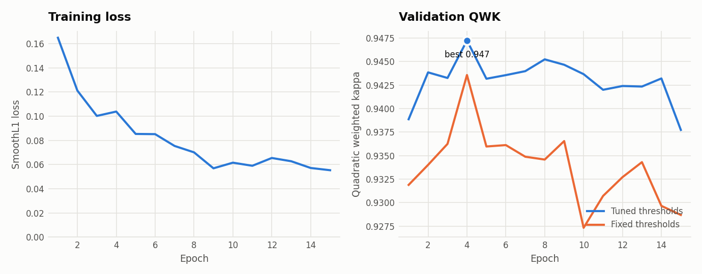
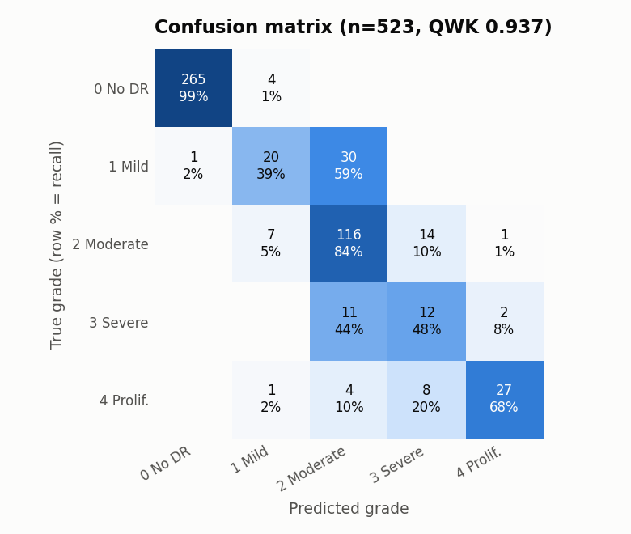
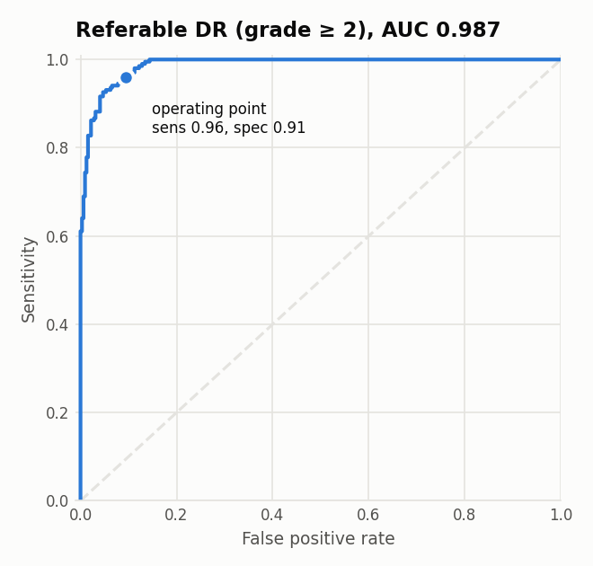
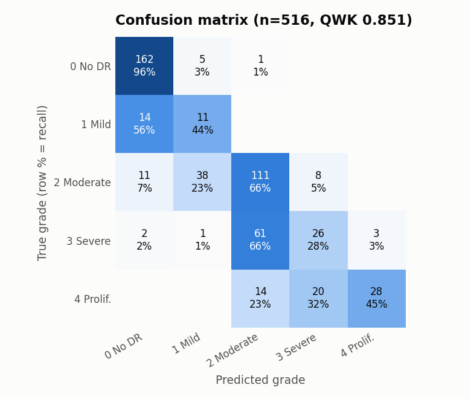
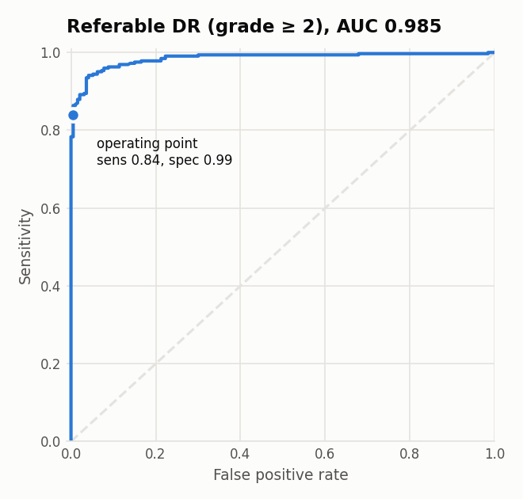
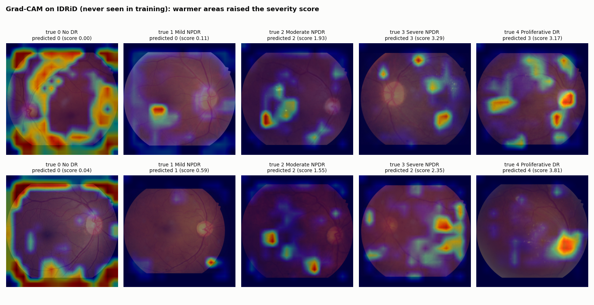
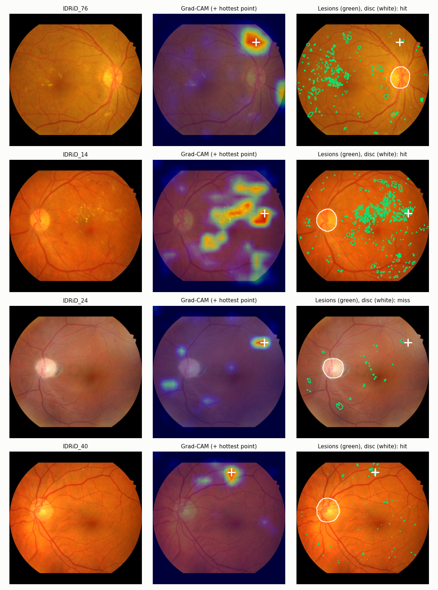

# Retinal DR Screening

Diabetic retinopathy grading from fundus photographs, built to generalise
beyond the dataset it was trained on:

- **Pretrained** on Kaggle EyePACS 2015 (~88k images)
- **Fine-tuned** on APTOS 2019 (3.6k images, Aravind Eye Hospital)
- **Externally tested** on IDRiD (516 images, a different Indian clinic and camera, never seen in training)
- **Explained** with Grad-CAM heatmaps
- **Demo** on Hugging Face Spaces

> Research project, not a medical device.

**Status:** baseline, EyePACS pretraining, external test on IDRiD, explainability
check and live demo done (results below). Next: ablations.

**Live demo:** [huggingface.co/spaces/ashwinruke/retina-dr-screening](https://huggingface.co/spaces/ashwinruke/retina-dr-screening)
runs the model in your browser, so photos are never uploaded.

## Results

Two models, both EfficientNet-B3 at 512 px, tested on the same images:

- **A0 (baseline):** ImageNet weights → fine-tuned on APTOS.
- **A1 (main model):** ImageNet weights → pretrained on all 88k EyePACS images
  (8 epochs, ~4.5 h on one Kaggle T4) → fine-tuned on APTOS.

The cut points between grades are fit on APTOS validation data (every grade
band at least 0.5 wide) and then frozen. IDRiD is never used for training,
model selection or tuning.

| | APTOS test (523) | | IDRiD, all 516 | |
|---|---|---|---|---|
| | A0 | **A1** | A0 | **A1** |
| Quadratic weighted kappa | 0.922 | **0.937** | 0.769 | **0.851** |
| Referable DR: ROC-AUC | 0.985 | **0.987** | 0.960 | **0.985** |
| Referable DR: sensitivity | 0.951 | **0.961** | 0.830 | **0.839** |
| Referable DR: specificity | 0.903 | **0.906** | 0.964 | **0.995** |
| Severe (grade 3) recall | 0.20 | **0.48** | **0.30** | 0.28 |
| Proliferative (grade 4) recall | 0.55 | **0.68** | 0.18 | **0.45** |

Referable DR = grade ≥ 2 (moderate or worse), the threshold for referral to an
eye specialist. The APTOS test split is 15% of the APTOS training set held out
before training, so it isn't comparable to the APTOS Kaggle leaderboard. On
IDRiD's official 103-image test set, QWK rises from 0.646 (A0) to 0.793 (A1).

### What EyePACS pretraining changed

- **The gap to a new clinic shrank by more than half.** A0 lost 0.153 QWK
  going from APTOS to IDRiD; A1 loses 0.086. Referable-DR AUC on IDRiD rose
  from 0.960 to 0.985, close to its APTOS level.
- **Proliferative disease is recognised far more often** on IDRiD
  (18% → 45%), and severe recall on APTOS more than doubled (20% → 48%).
  EyePACS has 1,940 severe and 1,773 proliferative training images; APTOS
  has about 115 and 175.
- **Severe disease on IDRiD is still the weak spot.** 61 of IDRiD's 93 severe
  eyes are graded moderate, so severe recall stayed at 28%. They are still
  flagged as referable, but without the urgency they need.
- **The referral cut-off is conservative on IDRiD.** At the frozen cut point
  A1 catches 84% of referable eyes with 99.5% specificity; most misses are
  moderate eyes graded mild. Read off the ROC curve, about 94% sensitivity is
  reachable at about 96% specificity, so a clinic adopting the model would recalibrate that
  one cut point on a small local sample.

### A1 on APTOS test



| | |
|---|---|
|  |  |

### A1 on IDRiD (external)

| | |
|---|---|
|  |  |

### Does the model look at the right things?

IDRiD includes 81 photos on which clinicians outlined every lesion
(microaneurysms, haemorrhages, hard and soft exudates) and the optic disc. For
each photo, A1's Grad-CAM heatmap was compared with those outlines in the
model's own 512 x 512 frame. Each score has a chance level next to it: what a
heatmap pointing at random spots on the retina would get.

| Check (81 photos) | A1 | Chance |
|---|---|---|
| Hottest point of the heatmap lands on a lesion (16 px tolerance) | **86%** | 39% |
| Share of the heatmap on lesions | **12.6%** (2.3x chance) | 5.5% (their share of the retina) |
| Share of the heatmap on the optic disc | **0.1%** | 2.6% |
| Hottest point on a haemorrhage | 48% | 15% |
| Hottest point on a hard exudate | 46% | 21% |
| Hottest point on a microaneurysm | 30% | 16% |
| Hottest point on a soft exudate (40 photos have them) | 10% | 4% |

- **It looks at lesions, not at shortcuts.** The hottest point lands on a lesion
  more than twice as often as chance, and the optic disc, a common shortcut for
  retina models, gets almost no attention.
- **Haemorrhages and hard exudates draw the most attention**, which fits:
  they are the larger lesions that mark moderate and severe disease.
- **Microaneurysms are the weakest match.** They are a few pixels across, while
  the heatmap comes from a 16 x 16 feature grid (32 pixels per cell), so it
  can't single them out.
- The chance level for "hits a lesion" is high (39%) because these photos were
  chosen for having many lesions, and the tolerance widens each one.





For eyes with no retinopathy (grade 0, first column above), nothing raises the
severity score, so Grad-CAM only stretches leftover noise to full colour, here
along the edges of the image. Those maps carry no meaning; the demo shows the
photo instead of a heatmap for grade 0.

### Cut points are fragile under a change of population

Tuning cut points on APTOS validation helps little and can hurt elsewhere.
On A0, the first version of the tuning squeezed the severe band to 0.19 wide
(fit to only 25 severe validation eyes) and graded only 9% of IDRiD's severe
eyes correctly. Requiring every band to be at least 0.5 wide raised that to
30%, and the plain defaults (0.5 / 1.5 / 2.5 / 3.5) did best on IDRiD (QWK
0.797 vs 0.769). The ranking of eyes, and so the referable-DR AUC, doesn't
depend on the cut points at all; only where the grade boundaries fall does.

### Full comparison

_Filled in as each step lands._

| Run | APTOS test QWK | IDRiD QWK | IDRiD referable AUC | IDRiD sens / spec |
|---|---|---|---|---|
| A0 · ImageNet → APTOS | 0.922 | 0.769 | 0.960 | 0.830 / 0.964 |
| **A1 · EyePACS → APTOS (main)** | **0.937** | **0.851** | **0.985** | **0.839 / 0.995** |
| A2 · A1 without Ben Graham | | | | |
| A3 · A1 with classification head | | | | |
| A4 · A1 + IDRiD fine-tune (IDRiD test only) | — | | | |

QWK = quadratic weighted kappa. IDRiD columns use all 516 images, except A4,
which trains on IDRiD's 413 training images and reports on its 103 test images
(on those 103: A0 QWK 0.646, A1 0.793). EyePACS pretraining reached 0.835
validation QWK on EyePACS itself; its labels are noisy, so that number is a
training signal, not a result.

## Data cleaning

APTOS contains the same photo several times, sometimes with different grades.
Copies that land on both sides of a train/test split inflate scores, and
conflicting labels are noise. Every image gets two fingerprints: its fine
detail (vessels, lesions) and its overall layout (optic disc position, which
eye). Two images count as copies only when both match.

| | Images |
|---|---|
| APTOS labelled images | 3,662 |
| Duplicate groups found | 131 |
| Extra copies removed (same grade, one kept) | 97 |
| Removed: copies with conflicting grades | 79 |
| **Used** | **3,486** |

Split 70 / 15 / 15, stratified by grade. Every flagged group is listed in
`data/manifests/aptos_duplicates.csv` for review.

## How it works

```
fundus photo → crop black border → pad to square → 512 px → Ben Graham normalisation
            → EfficientNet-B3 → GeM pooling → 1 regression output (severity 0–4)
            → thresholds tuned on val → grade 0–4 + Grad-CAM heatmap
```

Design decisions and their reasons are in [docs/PLAN.md](docs/PLAN.md):
why regression instead of 5-way classification, why patient-level splits on
EyePACS, why APTOS is deduplicated, and why IDRiD is held out entirely.

## Quickstart

### Dry run on synthetic data (CPU, ~1 minute)

```bash
pip install -r requirements.txt
python scripts/make_synthetic.py --out data/synthetic
python scripts/prepare_data.py --aptos data/synthetic/aptos --eyepacs data/synthetic/eyepacs \
    --idrid data/synthetic/idrid --out-dir data/manifests
python scripts/cache_images.py --manifest data/manifests/aptos.csv --out-dir data/synthetic_cache \
    --config configs/smoke.yaml --workers 2
python scripts/train.py --config configs/smoke.yaml
pytest
```

### Real training on Kaggle

Open [`notebooks/kaggle_pipeline.ipynb`](notebooks/kaggle_pipeline.ipynb) on
Kaggle, attach the three datasets, turn on GPU T4 x2 and Internet, and run it.
The steps it runs:

```bash
python scripts/prepare_data.py --aptos ... --eyepacs ... --idrid ... --out-dir data/manifests
python scripts/cache_images.py --manifest data/manifests/eyepacs.csv --out-dir cache --config configs/pretrain_eyepacs.yaml
python scripts/train.py --config configs/pretrain_eyepacs.yaml        # stage 1 (resumable: --resume .../last.pt)
python scripts/train.py --config configs/finetune_aptos.yaml          # stage 2
python scripts/artifacts.py push --tag <name> --run <run folders>     # save results (Kaggle wipes outputs)
python scripts/evaluate.py --checkpoint outputs/finetune_aptos/best.pt --manifest cache/aptos.csv --splits test \
    --fit-manifest cache/aptos.csv --fit-splits val --export outputs/model.pt
python scripts/evaluate.py --checkpoint outputs/model.pt --manifest cache/idrid.csv --splits all --name idrid
```

Any config value can be overridden on the command line, e.g.
`python scripts/train.py --config configs/finetune_aptos.yaml model.backbone=convnext_tiny train.epochs=20`.

### Demo

The live demo is a static page (`web/`) that runs the model in the visitor's
browser with ONNX Runtime Web, so photos never leave their device and it
needs no server. Everything after crop-and-resize (colour normalisation, the
network, flip TTA and Grad-CAM) is inside the exported ONNX graph, and the
export checks itself against the PyTorch pipeline.

```bash
pip install onnx onnxscript onnxruntime
python scripts/export_onnx.py --model outputs/model.pt --out-dir web \
    --check-images cache/aptos.csv --report outputs/eval/mvp_aptos_test.json
python -m http.server -d web 8000                  # preview at http://localhost:8000
HF_TOKEN=... python scripts/deploy_space.py --space <user>/retina-dr-screening
```

`app/app.py` is the same demo as a server-side Gradio app
(`MODEL_PATH=outputs/model.pt python app/app.py`).

## Repo layout

```
configs/      one YAML per experiment (stage 1, stage 2, baseline, IDRiD adaptation, smoke test)
src/retina/   preprocess · manifests · data · model · engine (train/predict) · metrics · gradcam
scripts/      prepare_data · cache_images · train · evaluate · plot_results · explain
              export_onnx · deploy_space · artifacts · benchmark_gpu · make_synthetic · build_space.sh
web/          in-browser demo (static page + ONNX model)
app/          the same demo as a Gradio app
notebooks/    Kaggle notebook running the full pipeline
tests/        unit tests + end-to-end test on synthetic data
docs/PLAN.md  project plan, design decisions, milestones
docs/figures/ result figures used in this README
```

## Data

The datasets are not included. Get them from their sources and follow their terms:

- [APTOS 2019 Blindness Detection](https://www.kaggle.com/competitions/aptos2019-blindness-detection) (Kaggle competition)
- [Diabetic Retinopathy Detection (EyePACS)](https://www.kaggle.com/competitions/diabetic-retinopathy-detection) (Kaggle competition)
- [IDRiD](https://ieee-dataport.org/open-access/indian-diabetic-retinopathy-image-dataset-idrid) (IEEE DataPort, CC BY 4.0)

## Limitations

- One image per eye, one model; no ensembling.
- Grades only DR; doesn't detect glaucoma, AMD or other conditions, and doesn't
  judge image quality.
- EyePACS labels are noisy; APTOS and IDRiD are small. The IDRiD result is the
  honest estimate of performance on a new clinic, and it is lower than APTOS test.
